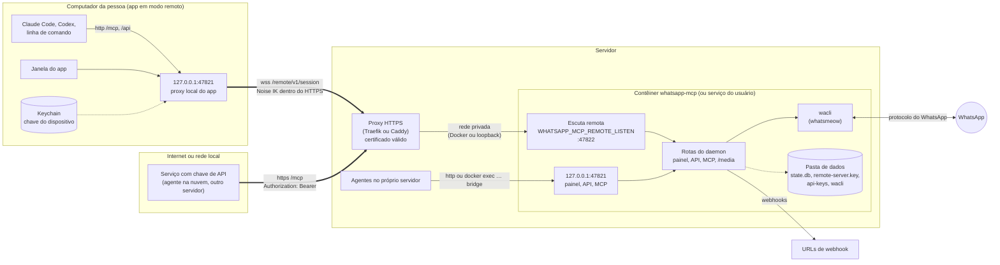
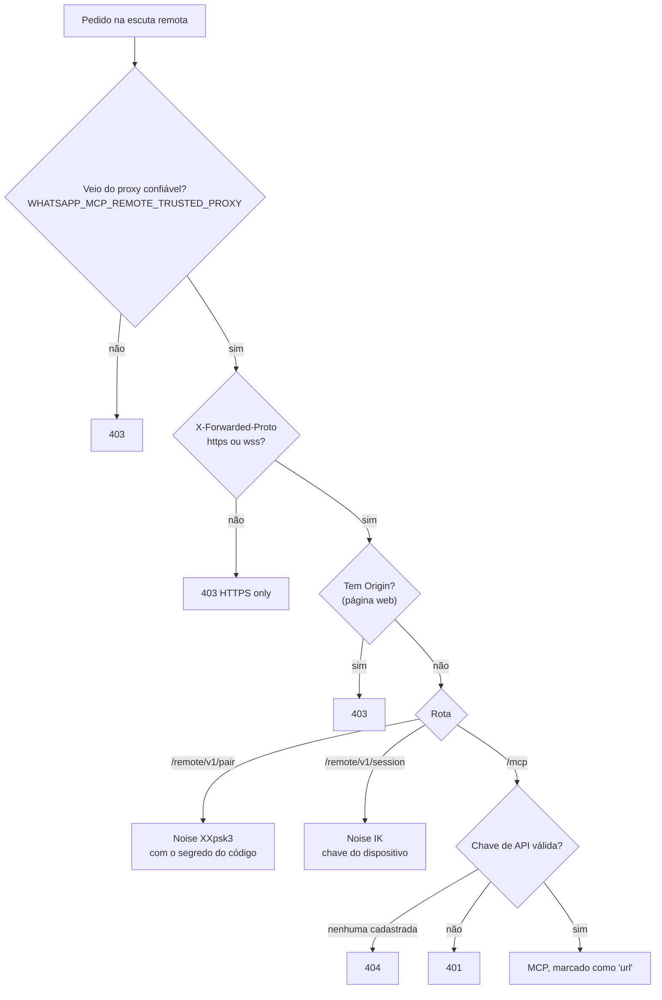
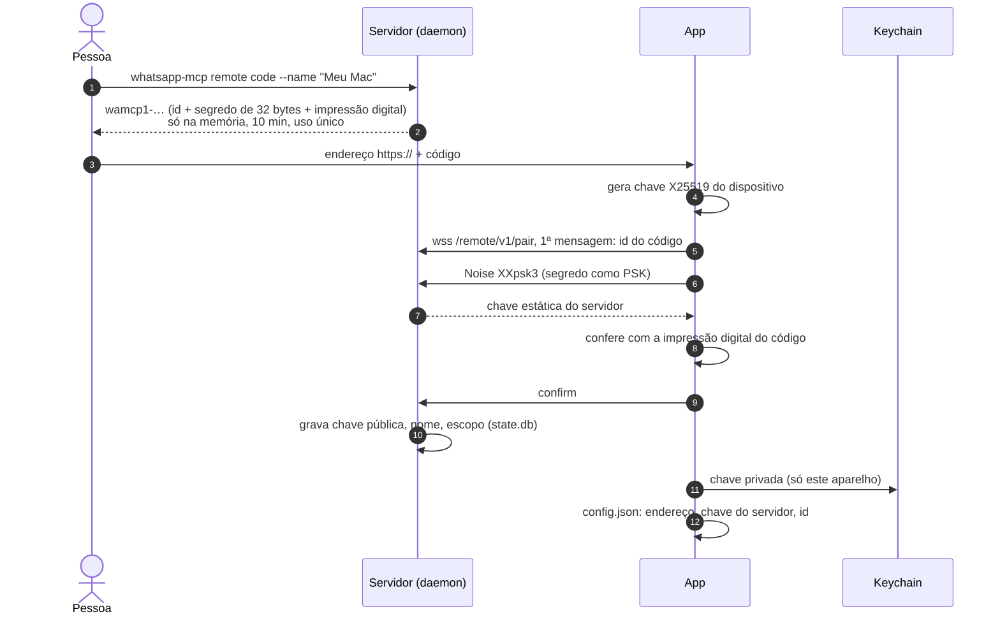
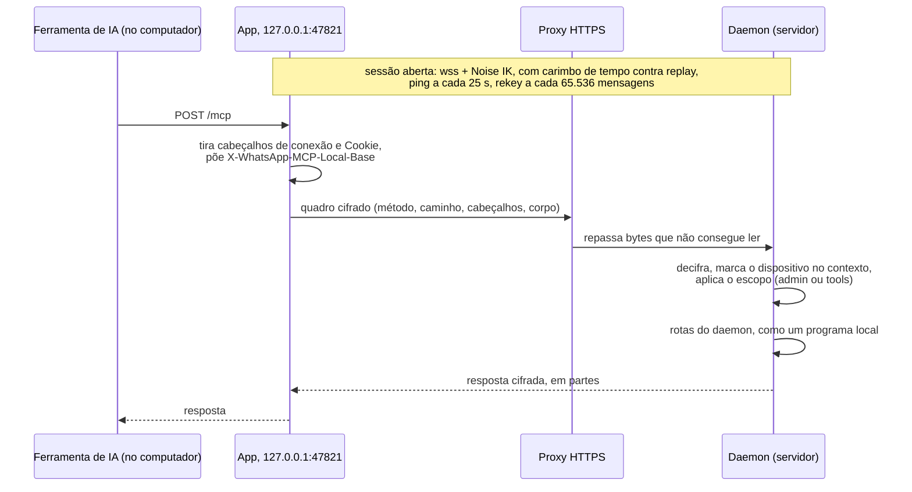
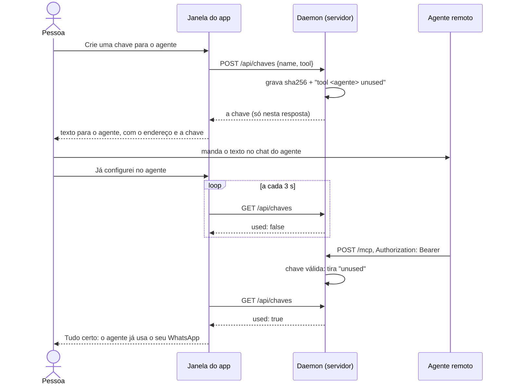

# Arquitetura do modo servidor

Como as peças do modo servidor se ligam: o daemon no servidor, o proxy HTTPS,
o app do computador e os serviços que usam o MCP por URL. O passo a passo de
instalação está em [Modo servidor](modo-servidor.md), os comandos em
[Num servidor sem tela](servidor.md), e os detalhes de criptografia em
[Acesso remoto](acesso-remoto.md).

## Visão geral

O WhatsApp roda só no servidor. O app do computador não roda o wacli no modo
remoto: ele vira um proxy local para o servidor, no mesmo endereço do modo
local, para que nada mude para as ferramentas de IA desse computador.

## As três portas de entrada do servidor

| Entrada | Onde escuta | Quem usa | Autenticação |
|---|---|---|---|
| Loopback | `127.0.0.1:47821`, dentro do servidor (ou do contêiner) | programas do próprio servidor, `docker exec … bridge` | só alcança quem está na máquina; token opcional (`whatsapp-mcp token`) |
| Sessão remota | `/remote/v1/pair`, `/remote/v1/session`, `/remote/v1/health` na escuta remota | o app de um computador pareado | Noise: pareamento por código, depois a chave do dispositivo em cada sessão |
| MCP por URL | `/mcp` na escuta remota | serviços que não rodam o app | chave de API (`Authorization: Bearer`); sem chaves cadastradas, responde 404 |

A escuta remota só existe com `WHATSAPP_MCP_REMOTE_LISTEN`. Ela nunca serve o
painel nem a API: só as rotas acima. Toda rota dela passa pelo mesmo filtro
(`guard` em `internal/remote/server.go`):

O proxy confiável aceita um IP, uma faixa ou o nome de um contêiner (refeito a
cada 30 segundos). Uma lista com erro de digitação não confia em ninguém. Sem
a variável, confia em quem alcançar a escuta, o caso de uma porta só no
`127.0.0.1` do servidor, onde só o Caddy chega.

## Pareamento do app

## Cada pedido do computador ao servidor

- **A janela do app** manda `X-WhatsApp-MCP-Window: 1`, e o servidor a serve
  como a janela do painel dele, com o token. O app tira esse cabeçalho do que
  chega pelo `127.0.0.1` dele, então nenhum outro programa se passa pela janela.
- **Os outros programas** do computador recebem as mesmas checagens de um
  programa no servidor: o token do servidor, se houver, e as regras do painel.
- **Os links do `download_media`** saem com a base do app
  (`X-WhatsApp-MCP-Local-Base`, aceito só se for `http://127.0.0.1:<porta>`),
  para abrirem no computador e não no loopback do servidor.
- **Escopo `tools`** alcança só `/mcp` e `/media/…`; o resto responde 403.

## O MCP por URL, com chave de API

Para um serviço que não roda o app (um agente na nuvem, outro servidor):

- `api-keys`, na pasta de dados (`/data/mcp` no Docker), guarda o **SHA-256 em hex** de cada
  chave, uma por linha, com um nome opcional depois de um espaço; `#` comenta.
  A chave em si não é guardada. Uma chave feita pelo painel ou pelo
  `apikey new` vira a linha
  `<sha256> <nome> # created <RFC 3339> tool <agente> unused`: `tool` diz de
  qual agente da página *Agentes remotos* ela é (só quando foi feita lá), e
  dá o logo dele nas listas.
- O arquivo é lido a cada pedido: apagar a linha revoga na hora. Sem arquivo,
  ou sem linhas, o `/mcp` da escuta remota responde 404.
- `unused` marca a chave que ainda não foi usada. O primeiro pedido aceito
  tira a marca; se ninguém a usar em 24 horas, ela deixa de valer e sai do
  arquivo na próxima leitura. Linhas sem a marca, como as escritas à mão, não
  expiram.
- A chave precisa ter pelo menos 32 caracteres, e a comparação é em tempo
  constante.
- Com a chave aceita, o pedido segue como o de um programa do servidor (com o
  token dele, se houver), marcado como "url" na lista de conexões do painel.
- O proxy precisa rotear `/mcp` além de `/remote/v1/`. O `install-docker.sh`
  hoje gera só a regra de `/remote/v1/`.

### Conectar um agente pelo app

A página do agente, em *Conectar ferramenta de IA › Agentes remotos*, é do
painel do servidor; o app a mostra pela sessão remota. A chave nasce no
servidor e só passa pela tela uma vez.

A espera vive só na página: recarregar a tela a perde, e a chave continua
valendo pelas 24 horas.

A tela do app *Gerenciar a conexão com o servidor* (`/__app/remoto`, servida
pelo próprio app) lista as mesmas chaves, com o agente, a data, *Em uso* ou
*Aguardando o primeiro uso*, e *Revogar*, que pede confirmação e apaga a
linha no servidor.

Aqui não há Noise: a proteção é o HTTPS até o proxy e a chave. Entre o proxy e
o contêiner o conteúdo anda em claro, na rede privada.

## Defesas do servidor para pedidos remotos

- **`send_media_message`** chamado por um dispositivo remoto não aceita
  caminho de arquivo e só baixa URLs da internet: endereços do próprio
  servidor, da rede local, de VPNs (`100.64.0.0/10`) e de metadados de nuvem
  são recusados depois do DNS e em cada redirecionamento (até 5),
  `internal/mcp/remotefetch.go`.
- **Limites:** 16 handshakes ao mesmo tempo, 5 s para a primeira mensagem,
  64 pedidos por sessão, 90 s sem mensagem encerra a sessão.
- **Revogar** um dispositivo derruba as sessões abertas dele na hora.
- **Trocar a chave** do dispositivo: a nova só vale depois de uma sessão
  provando que o app a tem; até lá a antiga continua valendo.

## Lista de conexões no painel

Cada cliente do MCP é registrado com o caminho por onde chegou (`via` na
tabela `clients` do `state.db`), e o painel os agrupa:

| `via` | Grupo no painel |
|---|---|
| `local` | Neste computador / No servidor |
| `app:<dispositivo>` | No computador *dispositivo*, pelo app |
| `url` | Direto no servidor, pelo endereço com chave |
| vazio | Caminho ainda não registrado (aparece no próximo uso) |

## Onde fica cada coisa

| Dado | Onde | Notas |
|---|---|---|
| Sessão do WhatsApp, mensagens | pasta do wacli no servidor | nunca sai do servidor |
| Chave estática do servidor | `remote-server.key` (0600) | apagar obriga a parear todos de novo |
| Dispositivos pareados | `state.db`, só chaves públicas | com nome, escopo, último carimbo |
| Chaves de API | `api-keys`, só SHA-256 | lido a cada pedido; nome, data, agente e a marca `unused` na mesma linha |
| Token do daemon | arquivo `token` na pasta de dados (0600) | opcional; vale para o `/mcp`, o `/health` e as ações da API |
| Chave privada do dispositivo | Keychain do computador | sem iCloud, só este aparelho |
| Endereço do servidor e sua chave fixada | `config.json` do app | |

## Código

| Peça | Arquivo |
|---|---|
| Rotas remotas, pareamento, sessão, `/mcp` por chave | `internal/remote/server.go` |
| Cliente do app, `https://` só, sem redirecionamento | `internal/remote/client.go` |
| Quadros de HTTP dentro da sessão | `internal/remote/mux.go` |
| Canal Noise | `internal/remote/channel.go` |
| Proxy confiável, cabeçalhos da janela e da base | `internal/remote/trust.go` |
| Ligação com o daemon, chaves de API | `internal/daemon/daemon.go` (`startRemote`), `internal/daemon/apikeys.go` |
| Páginas dos agentes remotos, `/api/chaves` | `internal/panel/apikeys.go`, `internal/panel/panel.go` (`agentGuides`) |
| Modo remoto do app, tela do servidor com as chaves | `cmd/app/remote.go`, `cmd/app/remotepage.go` |
| Downloads de um pedido remoto | `internal/mcp/remotefetch.go` |
| Instalação com Docker e proxy | `install-docker.sh` |
