# Relatório visual: acesso remoto

As telas que o acesso remoto mudou ou criou, capturadas da interface real (o
app do Mac compilado deste branch, `1.6.0-remote`), com dados de
demonstração: a conta "Fulano de Tal" e as conversas fictícias de
`scripts/preview/seed.sql`, num servidor de demonstração separado
(`whatsapp-mcp-demo.home.brorlandi.xyz`, montado só para estas capturas e
apagado depois). Nenhuma imagem traz token, código de pareamento, QR code ou
conversa de verdade. O funcionamento está em [Acesso remoto](acesso-remoto.md);
a instalação, em [Num servidor sem tela](servidor.md).

## No modo local

**1. Configurações › Acesso remoto (app no modo local).** Card novo. No app
que roda o WhatsApp no próprio computador, ele explica o modo remoto e leva à
tela de conexão.

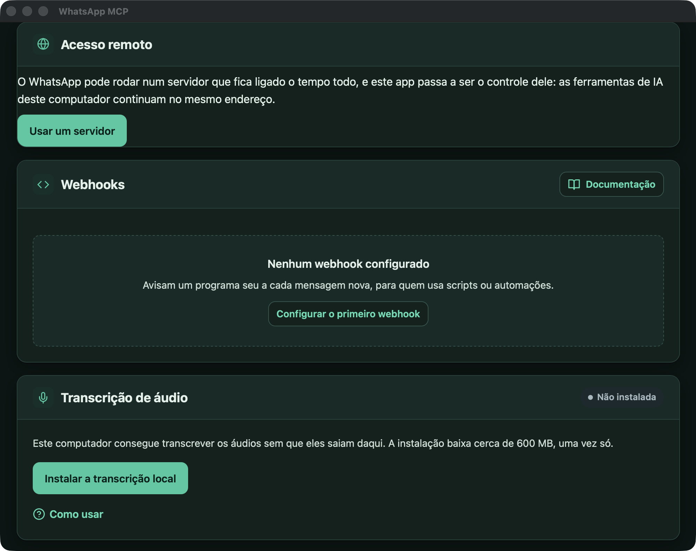

**2. Usar um servidor.** Tela nova do app (`/__app/remoto`). Pede o endereço
`https://` (o campo recusa outro), o código de pareamento e o nome do app no
servidor. A caixa *Levei os dados deste computador para o servidor* guarda a
sessão local à parte, para o Mac nunca abri-la junto com o servidor.

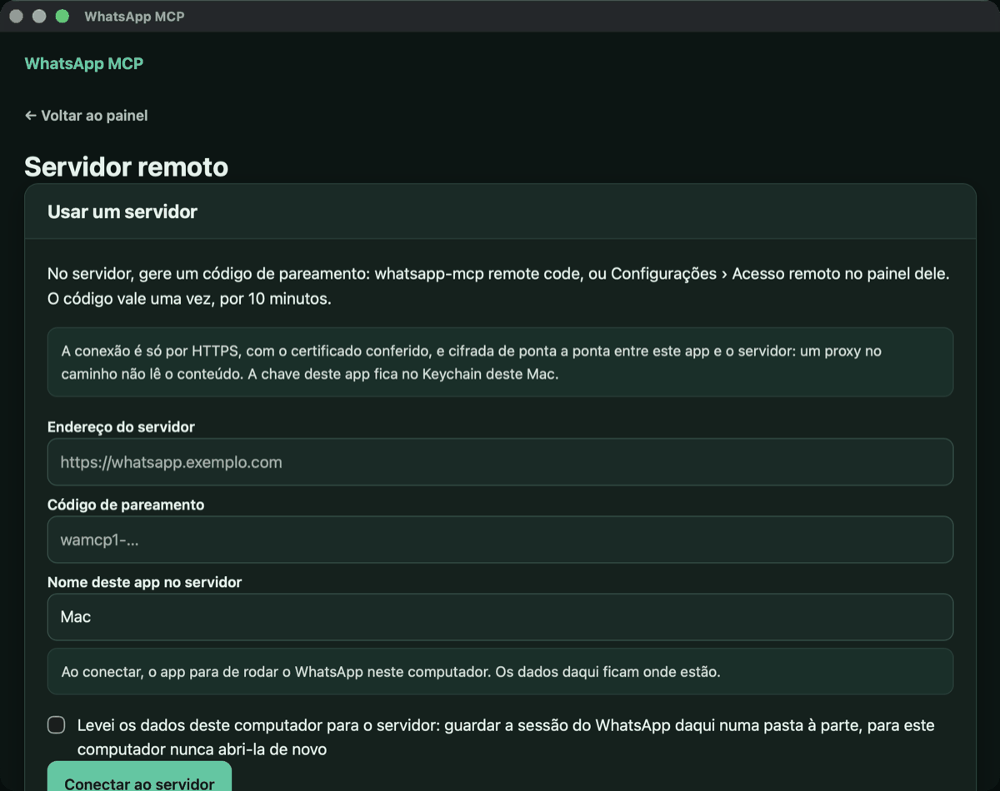

**3. Código recusado.** Um código incompleto, colado de propósito: o app diz
o que houve no idioma da tela e não muda de modo.

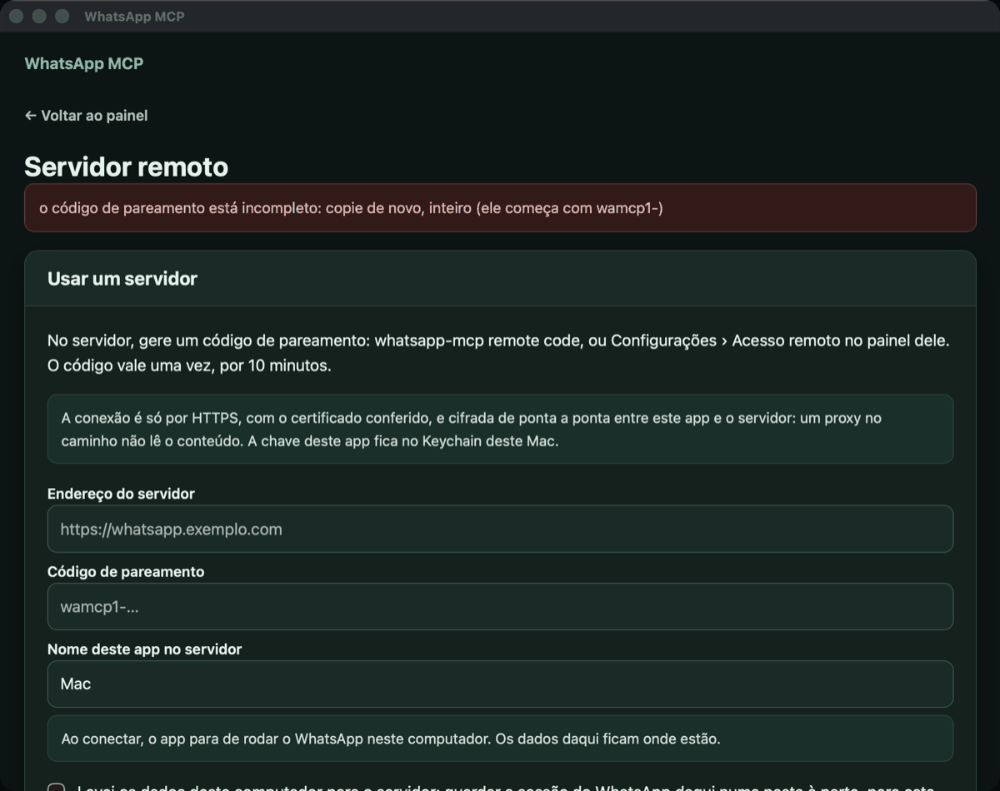

## No modo remoto, conectado

**4. Servidor remoto, conectado.** A mesma tela depois de parear: o servidor
em uso e as **duas conexões separadas**, a do app com o servidor e a do
servidor com o WhatsApp, cada uma com o seu estado. Os detalhes técnicos (a
impressão digital da chave do servidor, o id deste app) ficam no "?". Os
botões tentam de novo na hora e trocam a chave do app; abaixo, voltar ao modo
local.

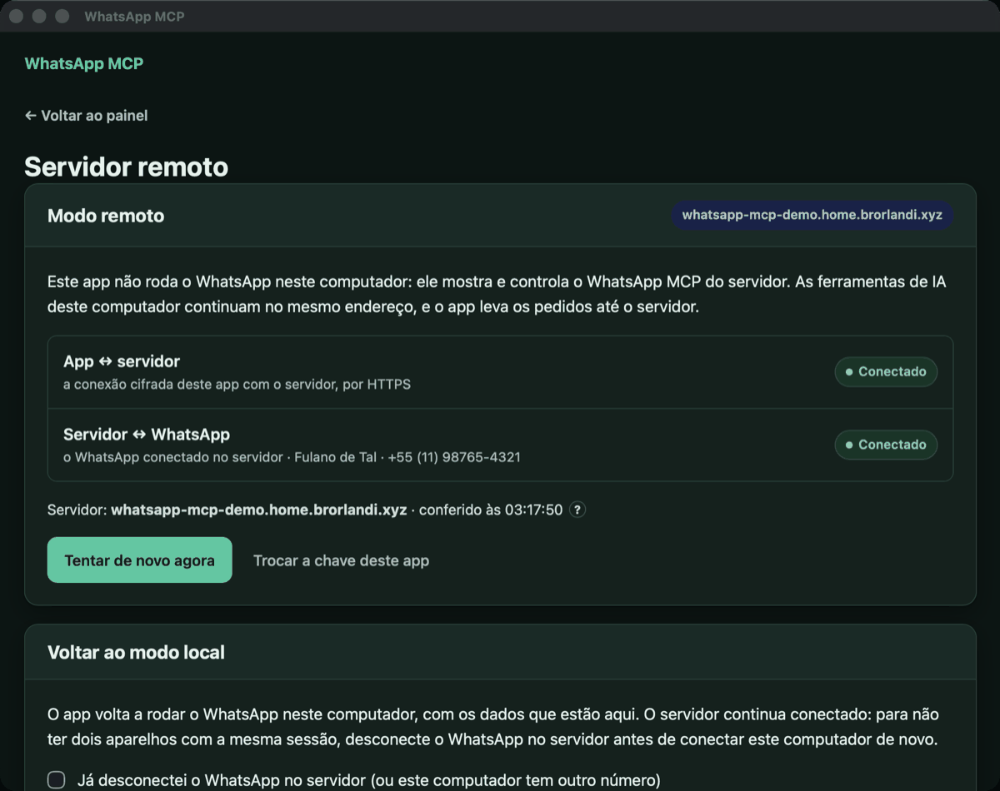

**5. Painel principal no modo remoto.** O painel vem do servidor, pelo túnel
cifrado. No topo de toda tela, inclusive na primeira, um aviso diz que o app
está no modo remoto, qual servidor usa e como estão as duas conexões, com o
link para gerenciar.

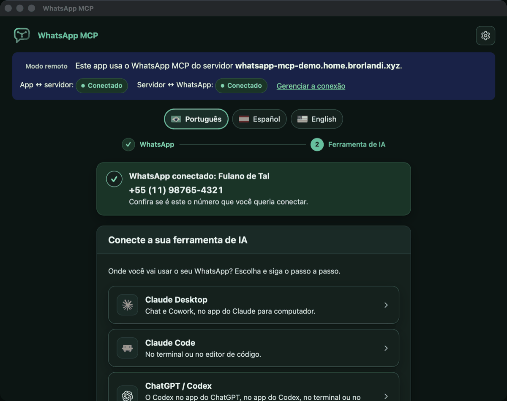

**6. Uma aba do painel (Status) no modo remoto.** O aviso aparece também nas
abas.

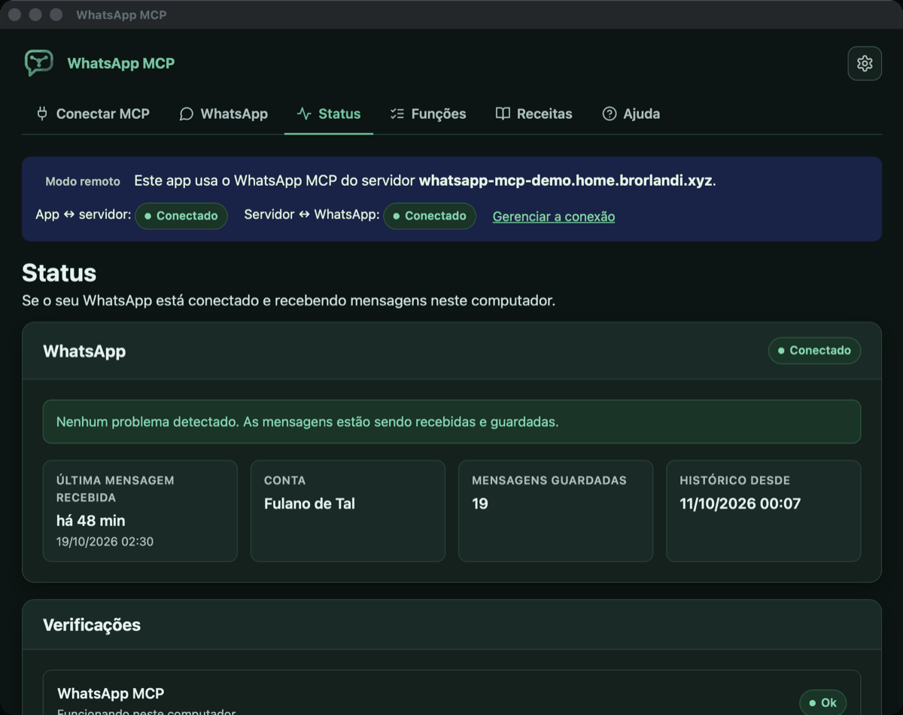

**7. Configurações › Acesso remoto (no modo remoto).** O card mostra os
aparelhos pareados ao servidor, marca "este app", e deixa revogar e gerar um
código para outro aparelho. O código, quando gerado, aparece só na tela, uma
vez, e não entra em nenhum endereço.

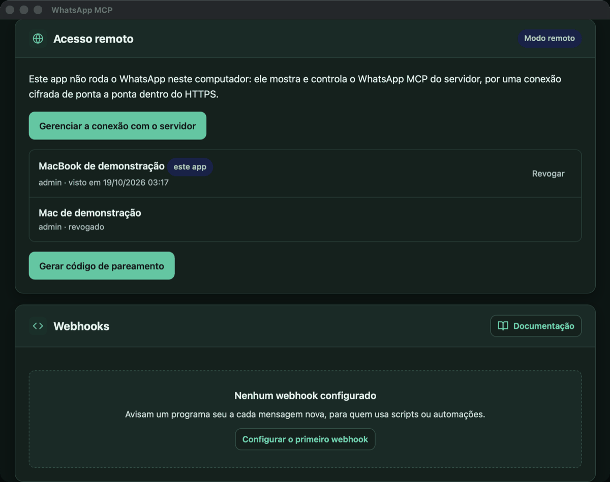

## Quando a conexão falha

**8. Reconectando, numa página aberta.** O servidor de demonstração foi
desligado com a página aberta: o aviso passa sozinho a *Reconectando* e o
WhatsApp do servidor a *Desconhecido*, porque o app não tem como saber. O
resto da página é o que o servidor mostrou da última vez.

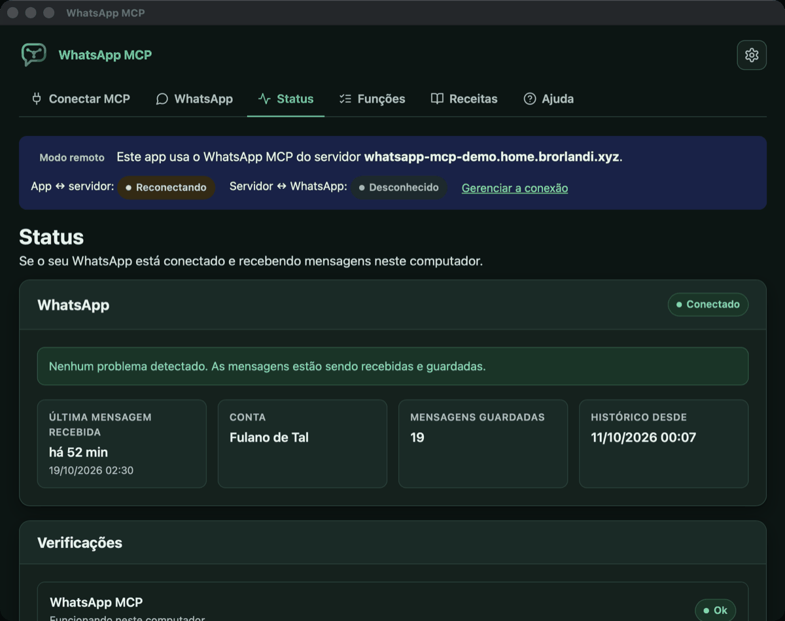

**9. Servidor remoto, reconectando.** A tela de conexão no mesmo momento; ela
se atualiza sozinha enquanto o app tenta de novo.

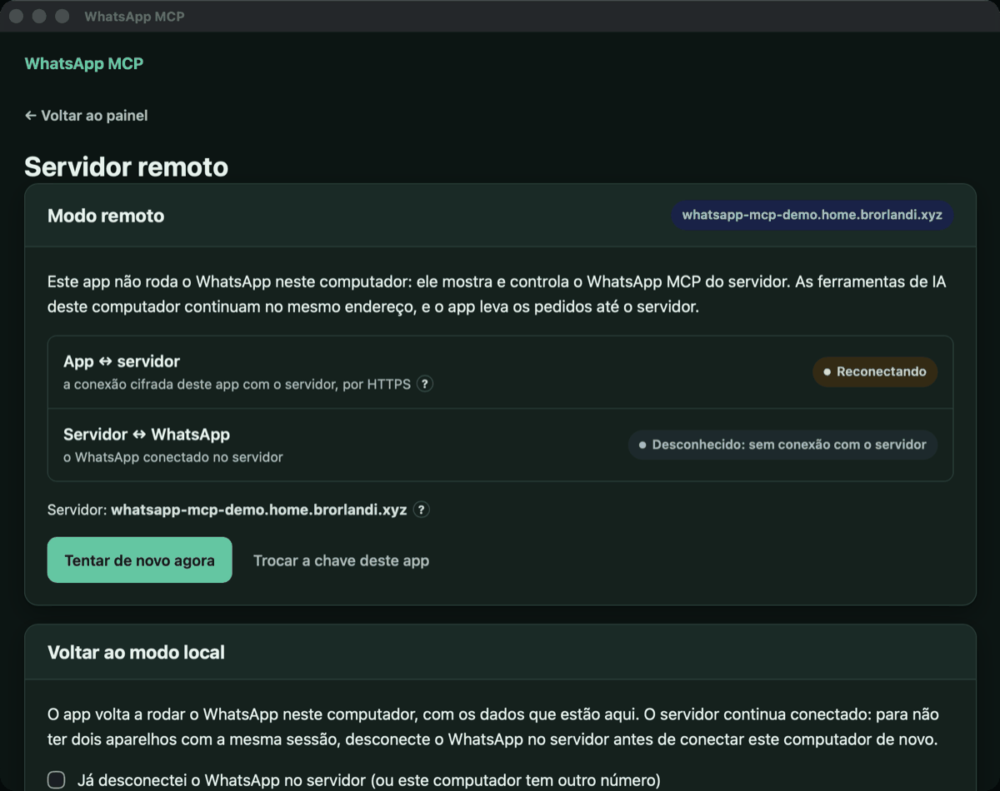

**10. Indisponível.** Depois de um minuto sem resposta, o estado vira
*Indisponível*.

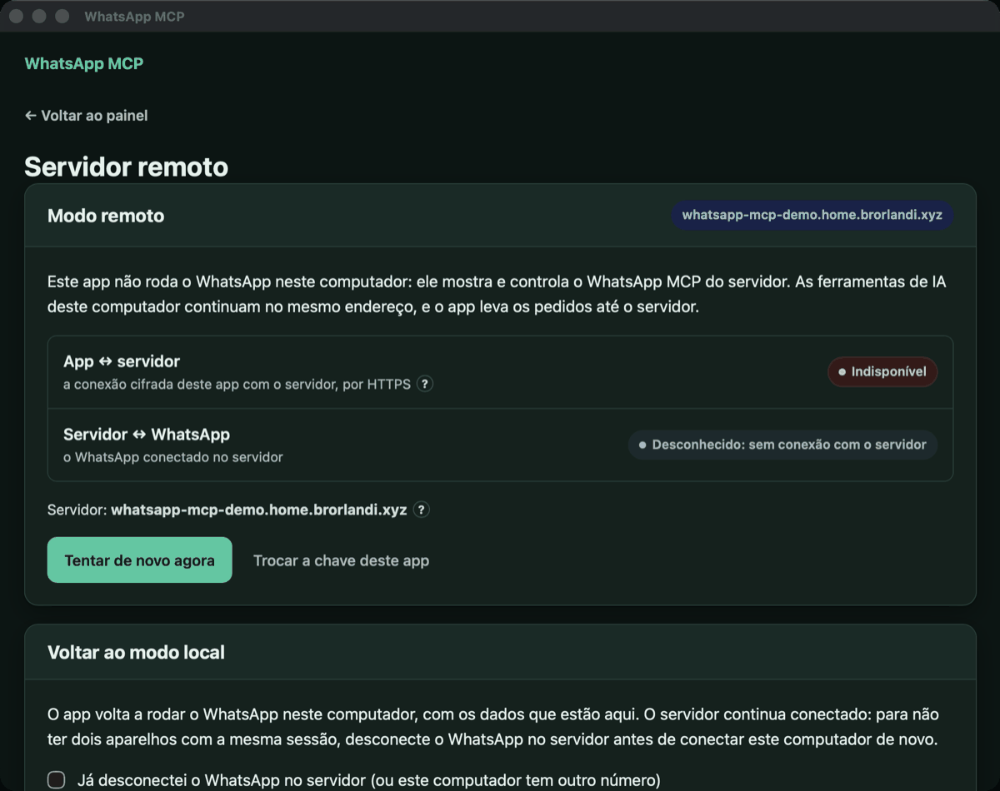

**11. Uma página pedida com o servidor fora do ar.** No lugar do painel, o
app mostra que está sem conexão com o servidor, com os dois estados.

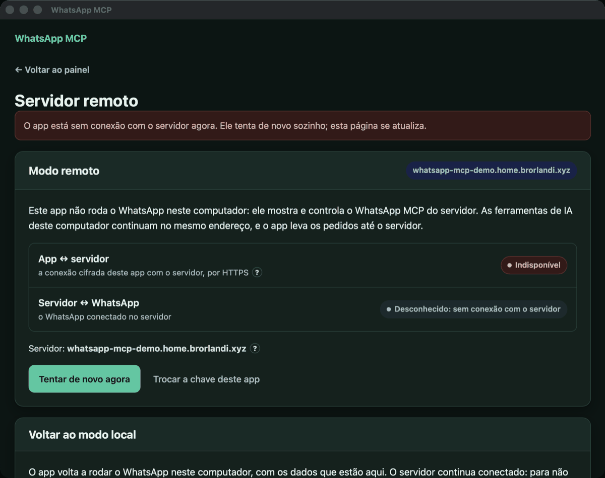

**12. O app conectado, o WhatsApp do servidor desconectado.** O servidor
voltou, mas sem WhatsApp conectado: a conexão do app aparece *Conectado* e a
do servidor com o WhatsApp, *Desconectado*. Nenhum sucesso aparece no lugar
do outro.

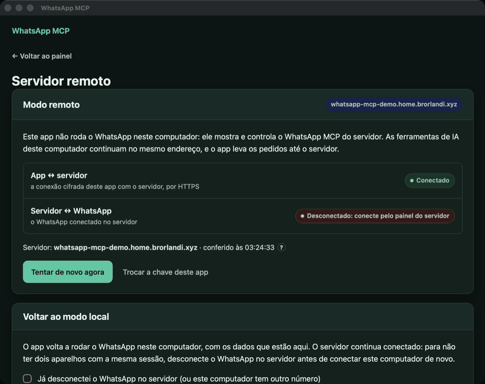

**13. Recusado pelo servidor.** O aparelho foi revogado no servidor
(`whatsapp-mcp remote revoke`): a sessão caiu na hora e o app mostra
*Recusado pelo servidor*; ele só volta pareando de novo.

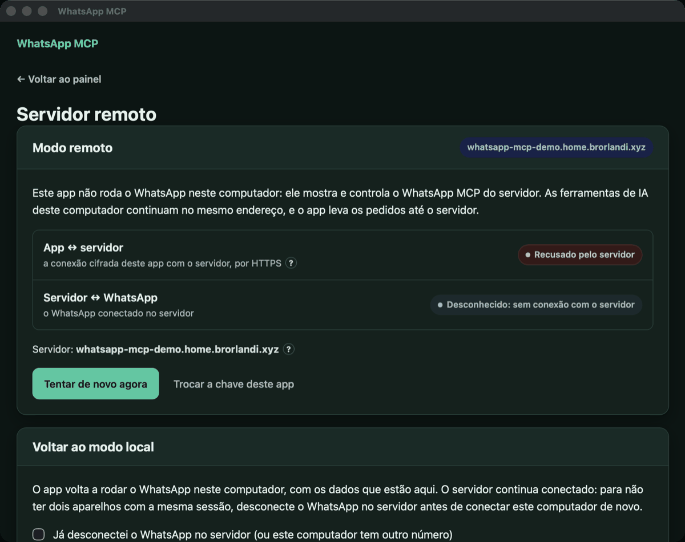

## Na linha de comando do servidor

Sem tela, a mesma gestão pelo terminal (aqui, no servidor de demonstração; o
código é omitido):

```
$ docker exec whatsapp-mcp-demo whatsapp-mcp remote code --name "MacBook"
Código de pareamento (vale uma vez, por 10 minutos; não aparece de novo):

  wamcp1-…

Impressão digital do servidor: 1606da6d28c5bebf

$ docker exec whatsapp-mcp-demo whatsapp-mcp remote
9276ac5eee73  MacBook de demonstração  admin  visto em 2026-10-19 03:17
94fa28c3743f  Mac de demonstração      admin  revogado

$ docker exec whatsapp-mcp-demo whatsapp-mcp remote revoke 9276ac5eee73
Dispositivo revogado: ele perde o acesso na hora e precisa ser pareado de novo.
```

## O que não está nas telas

- A bandeja do Mac também segue o servidor (o estado e "remoto: <servidor>"
  na linha de status), mas não foi capturada.
- As configurações próprias do app (abrir ao ligar, fechar para a bandeja,
  atualizações) não aparecem no painel remoto, que é o do servidor.
- Os textos do painel que dizem "neste computador" (como na aba Status) são
  os do servidor e não foram adaptados ao modo remoto.

## Como o app do Mac foi validado com o HomeServer

Sem capturas: daqui para a frente os dados são reais. A validação usou a
árvore de acessibilidade da janela e a API local, sem salvar imagem nem
conteúdo de conversa.

**Antes da troca.** A store do Mac foi conferida (`integrity_check` ok nos
três bancos; 2.456 conversas, 57.130 mensagens), o app que segurava a sessão
foi encerrado com o desligamento normal, e a pasta de dados inteira foi para
um backup com sha256, fora dela. O app antigo de `/Applications` também foi
para o backup, sem ser apagado.

**No servidor** (`whatsapp-mcp.home.brorlandi.xyz`, Docker atrás do Traefik
do HomeServer, só na LAN e no WireGuard). O contêiner parou, os dados dele
foram para um backup, e a store do wacli, o `state.db` (com 224
transcrições), a mídia e o modelo do Whisper vieram do Mac; o wacli é o mesmo
nos dois lados (0.20.0). O contêiner subiu e conectou com a sessão migrada,
sem QR code: `next: ready`, `health: ok`, as mesmas 57.130 mensagens. A
transcrição foi instalada no servidor (só processador). Pela rede, só
`/remote/v1/` responde, e só ao Traefik: outro contêiner da rede `proxy`
recebe 403.

**No Mac.** A store antiga foi guardada como `wacli.no-servidor-20261019`
(nenhum app volta a abri-la), o app `1.6.0-remote` foi instalado e pareado
com um código do servidor. Depois da troca:

- `GET http://127.0.0.1:47821/api/status` no Mac responde com a versão e o
  estado do servidor: WhatsApp conectado, pareado, `next: ready`, saúde ok;
- pelo MCP do Mac (o mesmo endereço que o Claude Code já usava), `tools/list`
  traz 40 ferramentas, `list_chats` e `search_messages` leem do servidor, e
  `whatsapp_status` mostra o sync conectado e a transcrição pronta;
- a janela mostra o aviso *Modo remoto* com o servidor, *App ↔ servidor:
  Conectado* e *Servidor ↔ WhatsApp: Conectado*; em *Configurações › Acesso
  remoto*, o aparelho "Mac do Bruno" marcado como *este app*, com *Revogar* e
  *Gerar código de pareamento*;
- nenhum wacli roda no Mac.

**Recebimento.** Sem mandar nada a ninguém: a primeira mensagem nova chegou
ao servidor cinco minutos depois da migração (o banco passou de 57.130 para
57.134 mensagens), e o `last_message_at` lido pelo Mac acompanhou.

**Para voltar ao estado anterior:** parar o contêiner (`docker compose stop`
em `/opt/homeserver/whatsapp-mcp`), encerrar o app do Mac, devolver
`wacli.no-servidor-20261019` ao nome `wacli` (ou restaurar o `.tar` do
backup) e o app 1.5.0 do backup para `/Applications`, e abrir o app.
